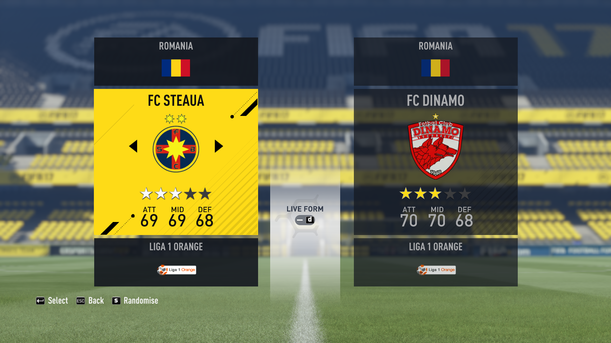
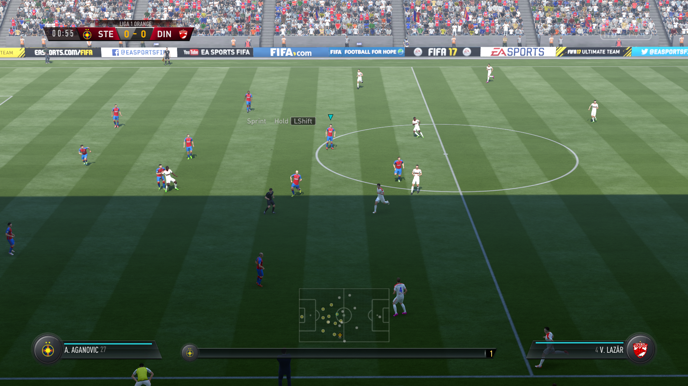

<!-- HEADER IMAGE -->
<p align="center">
  
</p>

<h1 align="center">⚽ FIFA 17 – Liga 1 Orange 16/17</h1>

<p align="center">
  <b>Romanian Liga 1 Orange 2016/2017 season mod for FIFA 17</b><br>
  Made for fun and nostalgia ✌️
</p>

---

## 📌 What this mod does

The mod replaces the Danish Superliga with the Romanian **Liga 1 Orange 2016/2017**. Players, kits, badges and team data come from **FIFA 16 with the FRLT V2 patch** and are written into **FIFA 17** (Frostbite) by a set of Python scripts and custom command-line tools. Other game versions are not supported.

### Status

- ✅ Romanian league replaces the Danish league (names, league structure, team colours, formations)
- ✅ Squads from FIFA 16 / FRLT, sorted by overall rating into the free FIFA 17 squad slots
- ✅ Kits (jersey, shorts, socks, minikits), crests and 3D badges
- ✅ Player minifaces (FIFA 16 photos, generic silhouette when a player has none)
- ✅ 3D league logo in the intro and replays
- ✅ Romanian language in the UI: all 32,025 texts translated and checked by a validator, language-select flag and label ([#6](https://github.com/Gabarsolon/fifa-17-liga-1-orange/issues/6)); looks fine in game, long texts not checked one by one
- ⬜ Romanian commentary ([#2](https://github.com/Gabarsolon/fifa-17-liga-1-orange/issues/2), [#3](https://github.com/Gabarsolon/fifa-17-liga-1-orange/issues/3)): researched, the game's commentary is EAOpus in EA containers; nothing implemented yet
- ⬜ Custom scoreboards, flags and banners ([#22](https://github.com/Gabarsolon/fifa-17-liga-1-orange/issues/22))
- ⬜ Player loans ([#20](https://github.com/Gabarsolon/fifa-17-liga-1-orange/issues/20)), formations ([#24](https://github.com/Gabarsolon/fifa-17-liga-1-orange/issues/24)), custom player heads ([#21](https://github.com/Gabarsolon/fifa-17-liga-1-orange/issues/21))

### Teams

| Team | Status |
|---|---|
| FCSB (Steaua), Astra Giurgiu, CFR Cluj, Viitorul Constanța, CS U Craiova, Dinamo București | ✅ done |
| ACS Poli Timișoara | ✅ imported with the new pipeline, confirmed working in Kick-Off |
| FC Botoșani, Pandurii Târgu Jiu, Poli Iași, FC Voluntari, Concordia Chiajna, Gaz Metan Mediaș, ASA Târgu Mureș | 🚧 imported with the pipeline (test projects only, [#12](https://github.com/Gabarsolon/fifa-17-liga-1-orange/issues/12)–[#18](https://github.com/Gabarsolon/fifa-17-liga-1-orange/issues/18)), waiting for the in-game check |

### Known limitations

- Commentary stays in English.
- Not everything is copied from FIFA 16 yet: team captain and set-piece takers, rivals, stadiums, managers and team ratings still hold the replaced Danish team's values ([#26](https://github.com/Gabarsolon/fifa-17-liga-1-orange/issues/26)).
- A squad is limited to the free slots of the replaced FIFA 17 team; extra FIFA 16 players are dropped ([#25](https://github.com/Gabarsolon/fifa-17-liga-1-orange/issues/25)).
- Players have generic 3D heads; only the 2D miniface comes from FIFA 16.
- Tested mostly in Kick-Off. Career Mode has not been checked team by team.

---

## 📷 Screenshots
| | | |
|---|---|---|
|  |  |  |

---

## 📦 Installation

1. Install **FIFA 17** (PC).
2. Install **Frosty Mod Manager**.
3. Import `Liga1Orange.fbmod` (or export a fresh one from `Liga1Orange.fbproject` with Frosty Editor, see below).
4. Apply the mod and launch the game from Frosty.

> `Liga1Orange.fbmod` is a build of the project at some point in time and can lag behind the repository. The source of truth is `Liga1Orange.fbproject`.

## 🎮 Compatibility

- Game: FIFA 17 (PC), Windows
- Modes: Kick-Off (tested), Career Mode (partly tested)

---

## 🛠 Tools

| Tool | Used for |
|---|---|
| [Frosty Editor / Mod Manager](https://github.com/CadeEvs/FrostyToolsuite) | Editing and applying the mod |
| [FrostyCLI](https://github.com/Gabarsolon/FrostyCLI) | Headless build of Frosty: inject databases, legacy files and textures, launch the game |
| [DbMasterCli](https://github.com/Gabarsolon/DbMasterCli) | Headless DB Master: export/import the `.db` tables |
| [CreationMaster16Cli](https://github.com/Gabarsolon/CreationMaster16Cli) | Headless Creation Master 16: export kits, crests and player photos from FIFA 16 |
| texconv (DirectXTex) | PNG to DDS |
| Python 3.12 | Import pipeline (`pandas`, `python-dotenv`, ...) |
| Photoshop / Blender | Hand-made kit and logo work |

The three CLIs are built from the decompiled sources of the original GUI tools and live in their own repositories.

---

## 📂 Project structure

```text
.
├── assets/
│   ├── league/              # League logo (2D and 3D sources)
│   ├── generic/             # Fallback assets (silhouette miniface)
│   └── teams/<team>/        # f16_raw (FIFA 16 export) and final (FIFA 17 ready) per team
│
├── db/
│   ├── *.txt                # TSV dumps of the FIFA 17 tables that the mod edits
│   ├── fifa-16/             # Reference tables from FIFA 16 (FRLT)
│   ├── original_tables/     # Pristine FIFA 17 baselines
│   └── translation_ro/      # Romanian translation work (batches, instructions)
│
├── scripts/
│   ├── import_team.py       # Import one team end to end
│   ├── validate.py          # Checks keys, ids, texture sizes before injecting
│   ├── ro_translate*.py    # Romanian translation pipeline
│   ├── import_league_logo.py, league_logo_mesh.py   # 3D league logo
│   └── menu.py              # Older interactive menu
│
├── AGENTS.md                # Detailed project notes and findings (read this first)
├── .env.example             # Template for the local paths
├── requirements.txt
├── Liga1Orange.fbproject    # Frosty Editor project
└── Liga1Orange.fbmod        # Exported mod
```

---

## 🧰 Working on the project

### 1. Requirements

- FIFA 17 and FIFA 16 (PC); FIFA 16 is only a data source and is never launched
- [FRLT V2 patch](https://dl.fifa-infinity.com/fifa-16/frlt-16-v2/) installed over FIFA 16 (gives the Liga 1 data)
- The three CLIs above, built with the .NET SDK
- texconv, Python 3.12, Git

### 2. Set up

```bash
git clone https://github.com/Gabarsolon/fifa-17-liga-1-orange.git
cd fifa-17-liga-1-orange
pip install -r requirements.txt
cp .env.example .env      # then fill in your own paths
```

All paths live in the git-ignored `.env`; never hardcode them in scripts.

### 3. Import a team

Teams are listed in `scripts/constants.py` (`liga1orange_teams`: FIFA 17 id of the Danish team it replaces, FIFA 16 id, foundation year, city).

```bash
python scripts/import_team.py <team_key>
# useful flags: --skip-db  --skip-assets  --skip-frosty  --fresh
```

The script replaces the players, team data and formations in the TSVs, exports and converts kits, crests and photos from FIFA 16, validates everything, rebuilds the databases with `DbCli` and injects the result into `Liga1Orange.test.fbproject` (created from the clean project and reused, so teams accumulate). Test that project in game; if it works, copy it over `Liga1Orange.fbproject`. Details and rules are in [AGENTS.md](AGENTS.md).

Important: whenever a database is rebuilt, inject both the `.db` **and** its `-meta.xml`, otherwise the game crashes at startup.

### 4. Other jobs

- Check data before injecting: `python scripts/validate.py`
- 3D league logo: `python scripts/import_league_logo.py`
- Romanian translation: `python scripts/ro_translate.py prepare | validate | merge`

---

## 🛠 Troubleshooting

### 🚫 Mod not showing in game
- Make sure the mod is applied in Frosty Mod Manager and launch the game through Frosty.
- Check for conflicts with other mods.

### 💥 Game crashes on launch
- Most startup crashes come from the database: always inject the `.db` together with its `-meta.xml`, and never use a database with duplicate keys.
- If the game does not start at all, a patched `CryptBase.dll` may be needed. Place it in the game folder, or inject it with [Extreme Injector](https://github.com/master131/ExtremeInjector) (helper script: [scripts/extreme_injector_loop.ps1](scripts/extreme_injector_loop.ps1)).
- Disable other mods, delete the `ModData` folder and let Frosty regenerate it, run Frosty as administrator.

### 👕 Kits / logos not appearing
- Check that team ids match in the database tables and the texture names.
- Verify the `teamkits` rows and that the textures were imported.
- Clear `ModData` and rebuild.

### 📊 Database changes not applying
- Run `python scripts/validate.py` (duplicate ids, missing references).
- Test in Kick-Off before Career Mode.

If the issue persists, open an issue with a clear description, screenshots, and your FIFA 17 and Frosty versions.

---

## 🤝 How to contribute

- Fix incorrect player data or update squads
- Improve kits, textures, faces, banners and flags
- Pick one of the open [issues](https://github.com/Gabarsolon/fifa-17-liga-1-orange/issues) (remaining teams, translation, loans, formations)
- Report bugs

Guidelines: keep the database structure consistent, do not overwrite unrelated tables, test in game before submitting, use clear commit messages, and open a pull request from a new branch with screenshots when relevant.

---

## ⚠ Disclaimer

This is a fan-made project. All rights belong to EA Sports and to the EFET team for the FRLT V2 patch.

## 👤 Author

Created by **Gabarsolon**. If you like the project, give it a ⭐
